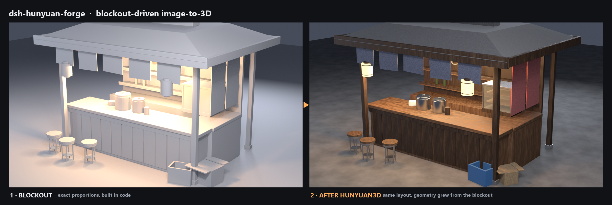

# dsh-hunyuan-forge

**Build the blockout yourself. Feed it to Hunyuan3D as the reference image. Auto-place the result back.**

Point-cloud-free, text-prompt-free, fully local 3D scene assembly: you control proportions
in code, an image-to-3D model fills in the detail, and the script puts every generated part
back exactly where its placeholder was.



English · [简体中文](README.zh.md)

> **Status: experimental / WIP.** Verified on one Windows machine, Blender 5.2.3, one scene.
> Prototype-grade code; interfaces will change. Not a production tool.

---

## The problem

Local Hunyuan3D takes an image, not a prompt. Text-to-3D needs a separate T2I checkpoint
(HunyuanDiT, several GB) that competes with the shape model for VRAM — on an 8 GB card that
trade is rarely worth it.

So most people either accept "prompt roulette" or hand-model everything.

This repo takes a third path: **the blockout is the image.**

```
reference / brief
      │  ① decompose into an asset list (size, position, who builds it)
      ▼
parametric structure (code) + placeholders (the model's input)
      │  ② render one canonical 3/4 view per placeholder (grey, no floor, full frame)
      ▼
Hunyuan3D img2mesh ──► white mesh GLB (it only adds surface detail)
      │  ③ import / clean / decimate / normalise / drop to floor / place by at+rot
      ▼
assembled scene ──► ④ procedural materials ──► ⑤ light & render ──► ⑥ export GLB
```

Because the silhouette comes from geometry you placed, the result lands at the right size,
the right position and the right orientation — no manual rescaling in Blender.

## How it compares

| | this repo | prompt-to-3D |
|---|---|---|
| Input | a blockout you control | a sentence |
| Proportions | exact, metric | random |
| Detail | limited by the blockout silhouette | imagined by the T2I model |
| Offline | ✅ fully local | usually needs an extra T2I checkpoint |
| Whole scene | ✅ many parts auto-placed | usually one asset at a time |

> For richer surface detail, the community approach inserts a **depth-ControlNet T2I** step
> (see [Tenitsky's guide](https://tenitsky.com/guides/simple-3d-shapes-to-tank-concepts/)):
> blockout → concept art → img2mesh. This repo exposes that as an optional `src=t2i` source
> but skips it by default, to stay offline.

---

## Requirements

| Component | Version | Notes |
|---|---|---|
| **Blender** | 5.2.x (tested 5.2.3) | builds geometry, renders references, places results |
| **Python** | 3.10+ | only for `gen_props.py` (`requests`) |
| **Hunyuan3D** | local **Hunyuan3D-2 mini/turbo** bundle | see [docs/hunyuan-deploy.md](docs/hunyuan-deploy.md) |
| **Bridge** | `bridge/server.py` in this repo | one POST → GLB bytes; see [docs/bridge.md](docs/bridge.md) |
| optional | DSH + `dsh-blender-plugin` | lets an agent drive Blender; not required |

Already have an img2mesh service? Point `HY3D_BRIDGE` at anything implementing
`POST /generate` (base64 image → `model/gltf-binary`) and `GET /health`.

## Quick start

```bash
git clone https://github.com/apple-pie99/dsh-hunyuan-forge.git
cd dsh-hunyuan-forge/examples/ramen
```

**① start Hunyuan3D (8080) and the bridge (8081)**

```bash
curl http://127.0.0.1:8081/health   # {"ok": true, "upstream": "http://127.0.0.1:8080"}
```

**② build the structure + reference images**

```bash
blender -b -P run_build.py
```

Look at `shots/*.png` before spending GPU time. If they don't read as the object, fix the
blockout — not the generator.

**③ generate (system Python, so Blender stays responsive)**

```bash
python gen_props.py
```

**④ place + materials + render + export**

```bash
blender -b stall_base.blend -P run_place.py
```

Outputs `render.png`, `stall.blend`, `stall.glb` (drop it into three.js).

Or run all three with the helper:

```powershell
.\run.ps1                     # finds Blender, checks the bridge, runs ②③④
.\run.ps1 -Blender "C:\Program Files\Blender Foundation\Blender 5.2\blender.exe"
```

## Repository layout

```
forge/                 core library (scene-agnostic)
├─ forge.py            placeholders / reference renders / bridge client / placement
├─ scene_spec.py       spec validation + difficulty routing (pure Python, unit-tested)
└─ rich_mats.py        procedural PBR materials (wood / steel / paper / cloth / concrete)
bridge/server.py       8081 adapter: REST → Hunyuan Gradio
docs/
├─ workflow.md         the six steps, with pass/fail criteria
├─ pitfalls.md         10 Blender/glTF/EEVEE gotchas we actually hit
├─ hunyuan-deploy.md   exact local deployment, limits, performance, licence
└─ bridge.md           what the bridge is, its security boundary, how to replace it
examples/ramen/        complete worked example: a Japanese street noodle stall
```

## Limitations

- **Procedural materials don't survive GLB export** — three.js only takes textures; bake first.
- **No PBR normal maps**: procedural grain repeats up close.
- **One image, no back side**: generated meshes break down when seen from behind.
- **One scene tested**: vegetation, cloth and characters are untried.
- **Windows-oriented**: scripts assume Windows paths.

## Licence

- **Code**: [MIT](LICENSE).
- **Example assets** (`examples/**`): CC BY 4.0 — see [NOTICE](NOTICE).
- **No model weights are distributed here.** Hunyuan3D runs locally under the
  TENCENT HUNYUAN 3D 2.0 COMMUNITY LICENSE: royalty-free for personal and commercial use,
  but **not licensed in the EU, UK or South Korea**; >1M MAU needs separate permission;
  no Tencent trademarks.
