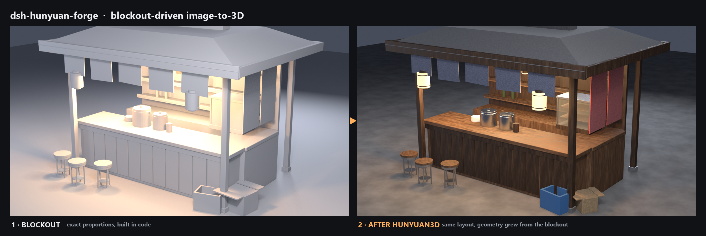

# dsh-hunyuan-forge

**自己搭白模，把它当成图生 3D 的输入图，再把生成结果自动摆回原位。**

不用文字提示词，也不用点云：比例在代码里定死，AI 只负责长细节，
脚本按占位体的位置、尺寸、朝向把每件产物放回去。



[English](README.md) · 简体中文

> **状态：实验性 / WIP。** 只在一台 Windows 机器、Blender 5.2.3、一个场景上验证过。
> 代码是原型级，接口会变。别直接当生产工具用。

---

## 解决什么问题

本地跑 Hunyuan3D 时最尴尬的一点：**它只吃图，不吃文字**。
纯文生 3D 要额外的 T2I 权重（HunyuanDiT，几个 GB），还要和 shape 模型抢那 8 GB 显存——
代价通常是"不值"。

于是大多数人要么抽卡，要么全部手搭。这个仓库走第三条路：**白模本身就是那张图。**

```
参考图 / 需求
      │  ① 拆解：资产清单（尺寸、位置、谁做）
      ▼
参数化结构（代码） + 占位体（模型的输入）
      │  ② 每个占位体渲一张标准 3/4 视图（灰底、无地面、撑满画幅）
      ▼
Hunyuan3D img2mesh ──► 白模 GLB（只负责"长肉"）
      │  ③ 导入 / 清理 / 减面 / 等比归一 / 落地 / 按 at+rot 摆放
      ▼
摆好的场景 ──► ④ 程序化材质 ──► ⑤ 布光出图 ──► ⑥ 导出 GLB
```

因为轮廓来自你亲手摆的几何体，产物天然落在对的位置、对的尺寸、对的朝向——
不需要再进 Blender 手动缩放。

## 与"文生 3D"的区别

| | 本仓库 | 文生 3D |
|---|---|---|
| 输入 | 你控制的白模 | 一句话 |
| 比例 | 精确到米 | 随机 |
| 细节 | 受白模轮廓限制 | 由 T2I 想象 |
| 离线 | ✅ 全本地 | 通常要额外 T2I 权重 |
| 整场景 | ✅ 多件自动归位 | 一般只出单件 |

> 想要更丰富的表面细节，社区做法是在中间插一步 **depth-ControlNet 文生图**
> （见 [Tenitsky 的指南](https://tenitsky.com/guides/simple-3d-shapes-to-tank-concepts/)）：
> 白模 → 概念图 → img2mesh。本仓库把它做成了可选项 `src=t2i`，默认跳过以保持离线。

---

## 依赖

| 组件 | 版本 | 说明 |
|---|---|---|
| **Blender** | 5.2.x（5.2.3 验证） | 搭结构、渲参考图、归位 |
| **Python** | 3.10+ | 只给 `gen_props.py` 用（需要 `requests`） |
| **Hunyuan3D** | 本地 **Hunyuan3D-2 mini/turbo** 整合包 | 见 [docs/hunyuan-deploy.md](docs/hunyuan-deploy.md) |
| **桥接** | 本仓库 `bridge/server.py` | 一次 POST 拿 GLB；见 [docs/bridge.md](docs/bridge.md) |
| 可选 | DSH + `dsh-blender-plugin` | 让 agent 直接驱动 Blender；不用也能全命令行 |

已经有自己的 img2mesh 服务？把 `HY3D_BRIDGE` 指向任何实现了
`POST /generate`（base64 图 → `model/gltf-binary`）和 `GET /health` 的服务即可。

## 快速开始

```bash
git clone https://github.com/apple-pie99/dsh-hunyuan-forge.git
cd dsh-hunyuan-forge/examples/ramen
```

**① 起 Hunyuan3D（8080）和桥接（8081）**

```bash
curl http://127.0.0.1:8081/health   # {"ok": true, ...}
```

**② 搭结构 + 出参考图**

```bash
blender -b -P run_build.py
```

**先看 `shots/*.png`** 再花 GPU 时间。图不像，改占位体，不要改参数。

**③ 生成（系统 Python，Blender 界面不卡）**

```bash
python gen_props.py
```

**④ 归位 + 材质 + 渲染 + 导出**

```bash
blender -b stall_base.blend -P run_place.py
```

产物：`render.png`、`stall.blend`、`stall.glb`（可直接丢 three.js）。

或者一条命令跑完：

```powershell
.\run.ps1                     # 自动找 Blender、检查桥接、依次跑 ②③④
.\run.ps1 -Blender "C:\Program Files\Blender Foundation\Blender 5.2\blender.exe"
```

## 目录

```
forge/                 核心库（与具体场景无关）
├─ forge.py            占位体 / 参考图 / 桥接客户端 / 归位
├─ scene_spec.py       清单校验 + 难度路由（纯 Python，有单测）
└─ rich_mats.py        程序化 PBR 材质（木/钢/纸/布/水泥）
bridge/server.py       8081 适配层：REST → Hunyuan Gradio
docs/
├─ workflow.md         六步法，带验收标准
├─ pitfalls.md         10 个实测踩过的坑
├─ hunyuan-deploy.md   部署版本、参数限制、性能、许可
└─ bridge.md           桥接是什么、安全边界、怎么替换
examples/ramen/        完整示例：日式街头拉面摊
```

## 局限

- **程序化材质不进 GLB**：three.js 只认贴图，要带质感得先烘焙。
- **没有 PBR 法线贴图**：近看纹理有重复。
- **单图没有背面**：转一圈会穿帮。
- **只验证过一个场景**：植被、布料、人物没试过。
- **偏 Windows**：脚本按 Windows 路径写的。

## 许可

- **代码**：[MIT](LICENSE)。
- **示例资产**（`examples/**`）：CC BY 4.0，见 [NOTICE](NOTICE)。
- **本仓库不包含任何模型权重**。Hunyuan3D 按 TENCENT HUNYUAN 3D 2.0 COMMUNITY LICENSE
  本地使用：个人与商用免版税，但**欧盟、英国、韩国不在授权范围**；月活 > 100 万需单独申请；
  不得使用腾讯商标。
