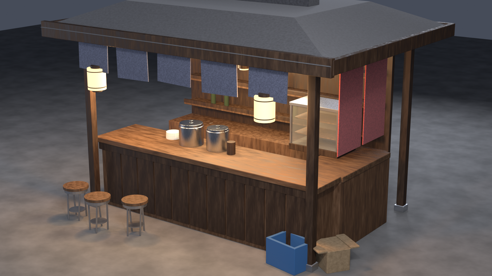

# 示例：日式街头拉面摊

一个完整的"结构自己搭 + 道具交给模型 + 自动归位"的例子。



## 跑

```bash
# 0. 起好 Hunyuan（8080）和桥接（8081），curl http://127.0.0.1:8081/health 返回 ok

# 1. 搭结构 + 出参考图（约 3 秒 + 每件 0.2 秒）
blender -b -P run_build.py

# 2. 生成 4 件道具（约 25 秒）
python gen_props.py

# 3. 归位 + 材质 + 渲染 + 导出（约 8 秒）
blender -b stall_base.blend -P run_place.py
```

产物：`render.png`、`stall.blend`、`stall.glb`。

## 文件

| 文件 | 作用 |
|---|---|
| `build_stall.py` | 摊体结构：立柱、雨棚、台面、货架、玻璃柜、凳子、灯笼 |
| `props.json` | 交给 Hunyuan 的 4 件：两口汤锅、纸箱、周转筐 |
| `run_build.py` | 第一步编排（Blender 内） |
| `gen_props.py` | 第二步编排（系统 Python） |
| `run_place.py` | 第三步编排（Blender 内） |

## 这 4 件为什么交给模型

- **汤锅**：筒身 + 盖 + 双耳，轮廓明确但边缘不规则，模型出来的钢质感比手搭好
- **纸箱 / 周转筐**：有翻盖、加强筋、圆角，手搭反而假

反过来，**灯笼、凳子、碗**是回转体，模型出来的会歪，所以留在 `build_stall.py` 里手搭——
这也是一条判断经验：**能用一个圆柱+倒角搞定的，别交给它。**

## 看什么

1. `shots/*.png`：灰模参考图。这四张不像，生成出来一定不像
2. `render.png`：归位后的整体。检查比例、朝向、是否穿地
3. `stall.glb`：丢进 <https://gltf-viewer.donmccurdy.com/> 转一圈，看背面有没有穿帮
